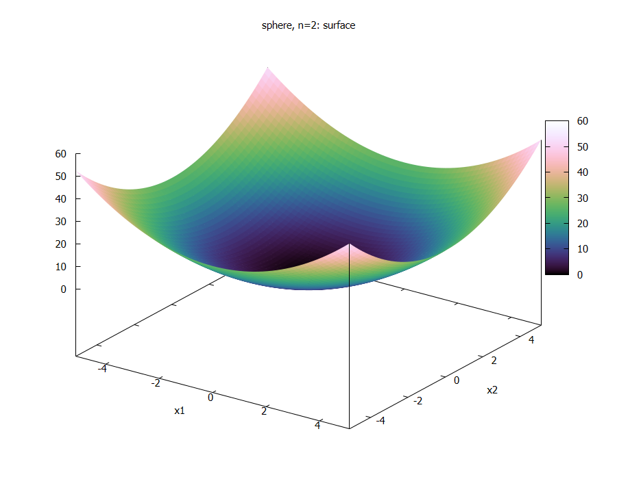
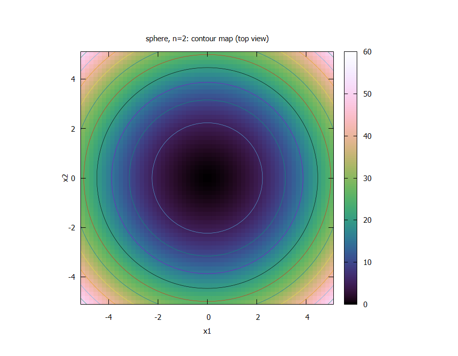
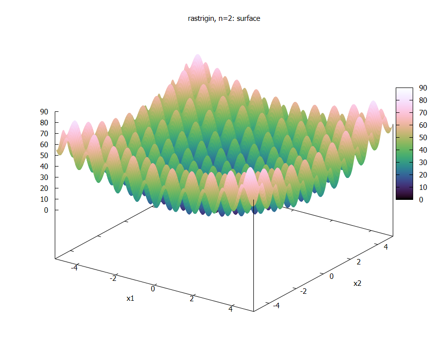
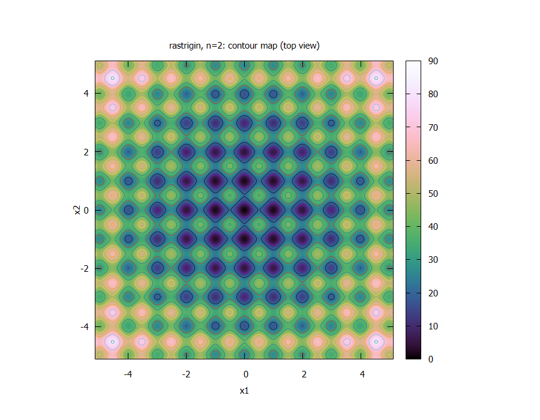

# Homework 2

# Jesus Ramirez

## Plots

The sphere only has one basin and no local minima. From any point, moving downhill leads to the optimal solution. This suggests that both methods should coverge, and the winner will be one that reaches the optium faster.

Rastrigin has many local minima arranged in a regular grid, while overall trend still points torward (0,0). This suggest that the methods may get trapped in a local minimum instead of reaching the center. When n = 10, the number of these traps grows exsponentially.

## Results

| function | method | best | worst | mean | std |
|---|---|---|---|---|---|
| Sphere | PSO | 5.931e-04 | 1.469e-02 | 5.354e-03 | 3.889e-03 |
| Sphere | DE | 6.609e-02 | 5.752e-01 | 1.794e-01 | 1.199e-01 |
| Rastrigin | PSO | 9.105e+00 | 4.321e+01 | 2.321e+01 | 8.365e+00 |
| Rastrigin | DE | 3.257e+01 | 6.316e+01 | 4.994e+01 | 8.181e+00 |

## Discuss

1. Which method reached a lower value on sphere? By how much, relative to the spread across runs?
Does the difference exceed the run-to-run noise?
2. Which method reached a lower value on Rastrigin? Is the ordering the same as on sphere? If it is
not, what property of the two landscapes explains it? Refer to your Part B figures.
3. Compare the standard deviations. A method with a better mean and a much larger spread is making
a different offer from one with a slightly worse mean and tight, predictable results. Which would you
choose for a system that must work every time, and why?
4. Neither method is expected to solve Rastrigin at this budget. Explain, in terms of how each
algorithm generates new candidates, why 50 generations is not enough.
5. State your conclusion and its limits, in the form: at this budget, on these functions, at these param
eters, over 30 runs, we observed X. Name one thing you would have to change to make a stronger
claim
## Answers

1. Sphere method: PSO performed much better than DE (5.35e-3 vs 1.79e-1). The difference is large, and even the worst PSO run was better than the best DE run. PSO won all 30 runs.

2. Rastrigin metod: PSO also performed better (23.2 vs 49.9), about two times better than DE. The ranking was the same as in Sphere, although there was some overlap between runs. Neither method reached 0 because of the many local minima.

3. Both methods had similar standard deviations, but PSO had a better average result and a better worst-case result. For a system that must work reliably, I would choose PSO.

4. Because PSO quickly stops exploring after converging to the global best particle. DE keeps making larger moves and cannot fine-tune the solution. Also, a 10-dimensional Rastrigin function has a huge number of local minima.

5. To conclude at a budget of 1530 evaluations, on 10-D Sphere and Rastrigin, over 30 runs, PSO achieved lower final values than DE on both functions. To make a stronger claim, I would test more DE parameters or use a larger evaluation budget.

